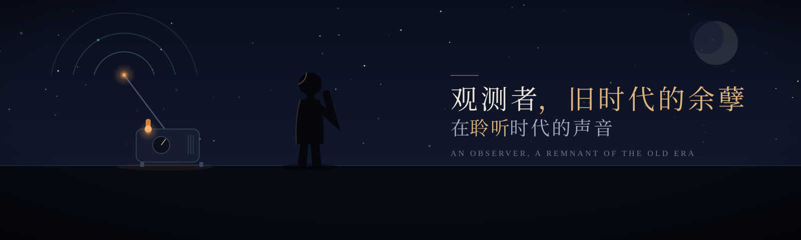

  

&nbsp;

## 试图征服世界

> *"Gee, Brain, what do you want to do tonight?"*
> *"The same thing we do every night, Pinky — try to take over the world!"*
>
> 「哎呀，大脑鼠，你今晚想做什么？」
> 「和我们每晚一样，粉红鼠——试图征服世界！」

这句台词出自 1995 年的动画《粉红鼠与大脑鼠》（*Pinky and the Brain*）。两只实验室小鼠每晚重复同一个问题，也重复同一个答案。多年以后，它成了全世界夜行者的接头暗号——

深夜十一点，办公室亮着最后一盏灯。有人问：今晚加班做什么？

> 和每天晚上一样，试图征服世界。

---

## 征服之路上的坐标

一些在深夜里写下的东西，按用途归档。

### LLM Agent · 智能采集

| 项目 | 简介 |
| --- | --- |
| [forager-faculty](https://github.com/jimmy-Smile-ltl/forager-faculty) | LLM 驱动的自适应高校教师信息采集框架：评估-修复-再评估闭环、四阶段流水线、五级反 WAF 请求栈 |
| [forager-epaper](https://github.com/jimmy-Smile-ltl/forager-epaper) | Paper Daily：中文日报自动采集流水线，一条命令生成生产级爬虫，自愈反馈环 + 零配置降级 |

### 爬虫框架与工程

| 项目 | 简介 |
| --- | --- |
| [jimmySpider](https://github.com/jimmy-Smile-ltl/jimmySpider) | 从 140+ 网站实战提炼的 Python 爬虫框架：6 种请求处理器、TLS 指纹伪装、断点续爬 |
| [clash_proxy](https://github.com/jimmy-Smile-ltl/clash_proxy) | 把机场闲置节点管成爬虫代理池：自动测速、轮换、封禁切换、挂掉自愈 |

### 反爬逆向 · 指纹 · 验证码

| 项目 | 简介 |
| --- | --- |
| [eg_ruishu](https://github.com/jimmy-Smile-ltl/eg_ruishu) | 瑞数 WAF 逆向方案集：12 个真实站点、25+ 技术路线，纯算法 / 补环境 / 浏览器三大技术族 |
| [eg_akamai](https://github.com/jimmy-Smile-ltl/eg_akamai) | gatekit：Akamai 挑战的探测 / 分析 / 求解工具包，判据全部可离线回归 |
| [captcha_example](https://github.com/jimmy-Smile-ltl/captcha_example) | 国内主流验证码样本库与求解器：9 家厂商、滑动 / 点选 / 旋转 / 五子棋 / POW 等类型 |
| [fingerprint](https://github.com/jimmy-Smile-ltl/fingerprint) | 浏览器指纹采集与 Node.js 补环境工具集：六大指纹维度全链路复现 |
| [eg_js_reverse](https://github.com/jimmy-Smile-ltl/eg_js_reverse) | JS 逆向最小化复现集：加密入口 → 算法还原 → 可运行验证 |

### 前端特效

| 项目 | 简介 |
| --- | --- |
| [show-your-heart](https://github.com/jimmy-Smile-ltl/show-your-heart) | JS Canvas 网页特效组合 |

---

  <i>—— 和每天晚上一样，试图征服世界。</i>

